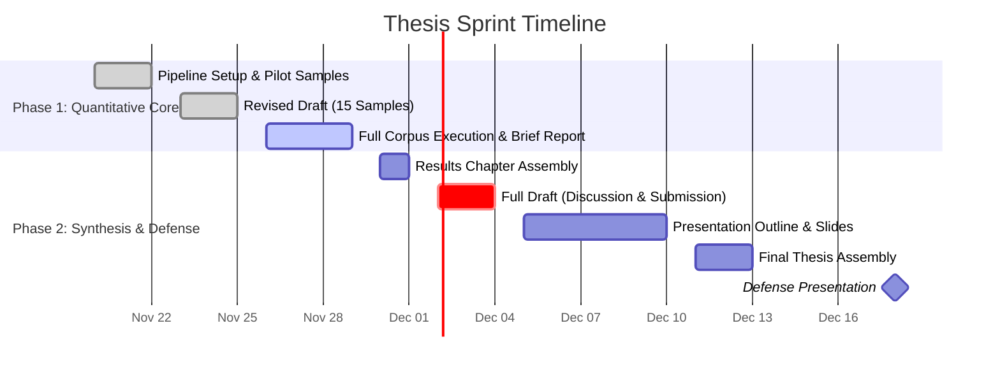
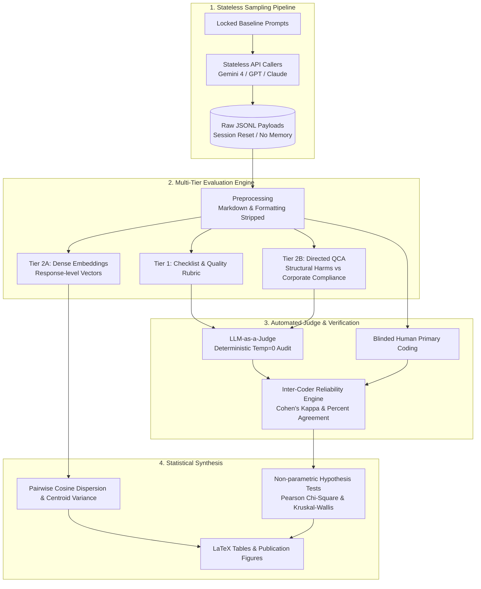

# __A Task-Anchored Audit of Epistemic Enclosure in Higher Education LLMs__

> __Master's Thesis Project__  
> __Author:__ Mengxi (Elean) Zhong  
> __Institution:__ Boston University, Faculty of Computing & Data Sciences  
> __Advisory Board Target Defense:__ December 18, 2026

[](https://www.python.org/downloads/release/python-3110/)
[](LICENSE)
[]()
[]()

This repository hosts the computational audit pipeline, empirical corpora, evaluation benchmarks, and publication manuscript for auditing epistemic enclosure in foundation models deployed within higher education settings.

The project adopts a modular, reproducible research architecture. The design decouples empirical pipeline execution (`src/`, `data/`) from academic document synchronization (`thesis/`), ensuring reproducible data operations alongside Overleaf-integrated LaTeX compilation.

---

## Research Roadmap & Milestones (Nov – Dec 2026)

### Sprint Planner 🗓️



<!-- ```mermaid
timeline
    title Thesis Sprint Roadmap (2026)
    section November
        22 : Pipeline setup report & code push
        25 : Revised draft (15-20 data examples)
        29 : Full corpus execution & results brief
    section December
        01 : Results chapter draft
        04 : Full draft submission to advisory board
        06 : Presentation outline & code freeze
        10 : Presentation slides draft
        13 : Final thesis assembly
        16 : Final slides sent out for review
        18 : Proposed thesis defense
``` -->

### Deliverables Matrix

| Target Date | Milestone / Objective | Status | Key Deliverables / Artifacts |
| :--- | :--- | :---: | :--- |
| __Nov 22__ | Pipeline setup report & pilot evaluation | ✅ Completed | `scripts/pipeline/`, pilot metric report |
| __Nov 25__ | Revised draft with 15–20 data examples | ✅ Completed | Chapter 2–3 draft, pivot sample charts |
| __Nov 29__ | Full pipeline execution & corpus results | 🔄 In Progress | Statistical outputs, table placeholders |
| __Dec 01__ | Results chapter draft | 🔄 In Progress | Draft Chapter 4 (Results) |
| __Dec 04__ | Full-picture draft submission | ⏳ Queued | Submission to Advisory Board |
| __Dec 06__ | Presentation outline & code freeze | ⏳ Queued | Public reproducible release |
| __Dec 10__ | Presentation slides draft | ⏳ Queued | Slide deck v1 |
| __Dec 13__ | Final thesis assembly | ⏳ Queued | Complete thesis PDF |
| __Dec 18__ | __Thesis Defense__ | 🎯 Goal | Final slides & defense recording |

---

## Cross-Audit Pipeline Architecture

The study implements a dual-task audit comparing epistemic uniformity in foundational conceptual tasks (Task 1: KNN explanation) against sociotechnical divergent framing (Task 2: AI ethics project ideation).

To ensure measurement reliability without manual subjective bias, data collection runs through a deterministic __LLM-as-a-Judge automated cross-audit loop__ paired with blinded human qualitative validation.

### Operational Workflow



### Operational Highlights

- __Stateless API Isolation:__ Each call runs as an independent session with tool grounding and synthetic personas disabled, capturing native probabilistic generation.

- __Deterministic Judge Protocol:__ The automated evaluator runs zero-temperature audits against structured rubric anchors, eliminating scoring drift across batch runs.

- __Dual-Track Verification:__ Blinded primary human annotations are cross-evaluated against the LLM judge to track Cohen's $\kappa$ agreement metrics directly before downstream statistical testing.

> For detailed judge prompt templates, API timeout rules, and audit trail schemas, see the [Pipeline Operations Protocol](doc/pipeline_ops.md).
---

## High-Level Repository Architecture

To maintain a clean working footprint, detailed file trees, schemas, and chapter mappings are offloaded to dedicated documentation.

- Complete File Structure & Module Responsibilities: See [Project Architect](doc/architecture.md) for the exhaustive project tree and directory manifest.
- Judge Specs & Fault Handling Runbook: See [Pipeline Operations Protocol](doc/pipeline_ops.md) for judge prompts, session resets, and retry policies. 
- Rubric & Coding Decision Trees: See [Pedagogical Audit Codebook & Scoring Protocol](doc/codebook_v1.1.md) for Tier 1 checklists and Tier 2B QCA boundary definitions.

```text
MSDS-Thesis-Project/
├── configs/          # Locked zero-shot prompts and model endpoint decoding parameters
├── docs/             # Protocols, detailed file manifests, and coding handbooks
├── data/             # Stateless JSONL corpora, blinded annotations, and dense embeddings
├── src/              # Python pipeline: API execution, embedding generators, LLM judge, analytics
├── notebooks/        # Exploratory workflows, dispersion plots, and ICR audit notebooks
└── thesis/           # Modular Overleaf-synchronized LaTeX dissertation source
```

---

## Quickstart & Reproducibility Runbook

### 1. Environment Setup

Clone the repository and set up the Python environment for running experiment code:

```bash
git clone [https://github.com/YOUR_USERNAME/MSDS-Thesis-Project.git](https://github.com/YOUR_USERNAME/MSDS-Thesis-Project.git)
cd MSDS-Thesis-Project

# Create and activate virtual environment
python -m venv .venv
source .venv/bin/activate  # On Windows: .venv\Scripts\activate

# Install dependencies
pip install -r requirements.txt
```

### 2. Compiling the LaTeX Manuscript

You can edit and compile the thesis either via Overleaf or locally.

- __Option A:__ Overleaf (Recommended for Writing)

Set thesis/main.tex as the Main Document in the Overleaf project settings.

- __Option B:__ Local Compilation

The LaTeX project is decoupled for fast modular compilation. To compile locally from the CLI, navigate to the `thesis/` directory or specify the root file:

```bash
# Navigate to the thesis directory
cd thesis

# Compile using latexmk with Biber backend
latexmk -pdf -bibtex main.tex

# Clean temporary build artifacts
latexmk -c
```

If using VS Code with LaTeX Workshop, open `thesis/main.tex` and trigger `Build LaTeX project`.

> __Tip for Overleaf / Fast Iteration:__ To compile a single chapter in isolation while maintaining cross-references and page numbers, uncomment `\includeonly{chapters/ch03_methodology}` in `thesis/main.tex`.

### 3. Configuration Credentials

Copy the environment template and insert your respective developer keys:

```bash
cp .env.example .env
```

Ensure `.env` contains valid credentials:

```env
OPENAI_API_KEY=your_openai_api_key_here
ANTHROPIC_API_KEY=your_anthropic_api_key_here
GEMINI_API_KEY=your_gemini_api_key_here
```

### 4. Run Pipeline Stages

Execute the collection, evaluation, and statistical pipelines sequentially:

```bash
# Step 1: Collect stateless sample batches (N=15 validation or N=50 full)
python -m src.api_execution.run_batch --config configs/models_baseline.json --batch pilot_n15

# Step 2: Run deterministic LLM-as-a-Judge cross-audit
python -m src.cross_audit.evaluate_judge --input data/raw/pilot_n15/ --rubric configs/rubric_tier1_tier2b.json

# Step 3: Extract dense embeddings and compute Tier 2A dispersion
python -m src.embeddings.generate_vectors --input data/processed/pilot_n15/
python -m src.analytics.compute_dispersion --embeddings data/embeddings/

# Step 4: Run hypothesis tests and generate manuscript artifact tables
python -m src.analytics.run_statistical_tests --output thesis/tables/
```

---

## Git & Overleaf Sync Workflow

The nested `thesis/` folder synchronizes directly with Overleaf via `git subtree`:

> Details see: [Synchronization Doc](doc/git_overleaf_workflow.md)

```text
┌─────────────────────────────────────────────────────────────┐
│                    GitHub Root Repository                   │
│  ├── data/                                                  │
│  ├── src/                                                   │
│  └── thesis/ ─── (Git Subtree) ───► Overleaf Remote (main)  │
└─────────────────────────────────────────────────────────────┘
```

### Pull Updates from Overleaf

```bash
git subtree pull --prefix=thesis overleaf main --squash
```

### Push Updates from Overleaf

```bash
git subtree push --prefix=thesis overleaf main
```

### Push Entire Project to Github

```bash
git add .
git commit -m "feat(pipeline): complete cross-audit run and update chapter 4 tables"
git push origin main
```

---

## Citation & License

This repository is maintained for academic research purposes. All source code in `src/` is open under the MIT License, while thesis text content in `thesis/` remains copyrighted by the author.

If you reference this dataset, codebase, or theoretical framework in your research, please cite:

```bibtex
@mastersthesis{Zhong2026EpistemicEnclosure,
  author  = {Zhong, Mengxi},
  title   = {A Task-Anchored Audit of Epistemic Enclosure in Higher Education {LLMs}},
  school  = {Boston University},
  department = {Faculty of Computing \& Data Science},
  year    = {2026},
  month   = {September}
}
```
