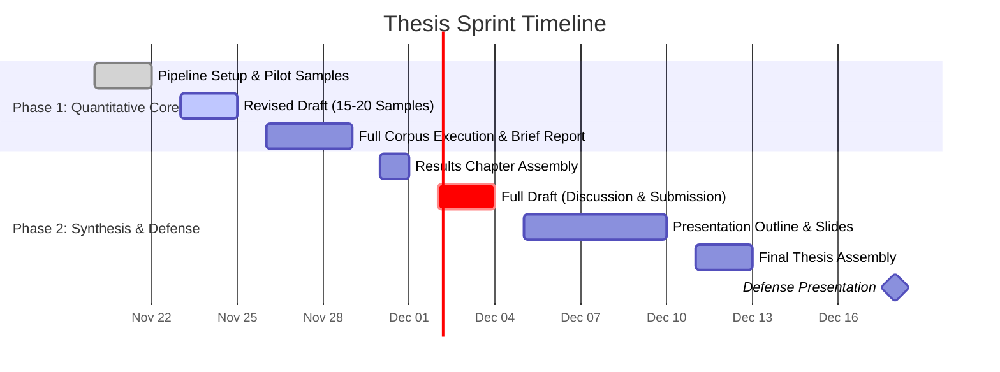

# __A Task-Anchored Audit of Epistemic Enclosure in Higher Education LLMs__

> Master's Thesis Project in Computing & Data Science  
> __Author:__ Mengxi (Elean) Zhong  
> __Institution:__ Boston University

This repository contains the complete computational pipeline, raw data corpora, and modular LaTeX source.

The project adopts a modular, reproducible research architecture: the root directory manages data extraction, modeling, and analysis pipelines, while the nested `thesis/` directory manages the academic publication document synchronized with Overleaf.

---

## Repository Structure

```text
MSDS-Thesis-Project/
├── README.md                      # Primary documentation and build instructions
├── .gitignore                     # Git rules for TeX build artifacts & Python caches
├── LICENSE                        # Project MIT license
│
├── data/                          # Experimental dataset storage
│   ├── raw/                       # 300 stateless API raw JSON execution payloads
│   ├── processed/                 # Normalised text outputs & metadata matrices
│   └── embeddings/                # Sentence embedding vectors & BERTopic outputs
│
├── src/                           # Computational pipeline & empirical scripts
│   ├── api_execution/             # Automated stateless zero-shot API callers
│   ├── preprocessing/             # Markdown strippers & text normalization
│   ├── embeddings/                # High-dimensional sentence vector generators
│   └── analytics/                 # Cosine distance variance, BERTopic & QCA pipelines
│
├── notebooks/                     # Exploratory Data Analysis & visual plots
│   ├── 01_data_exploration.ipynb  # Summary statistics & token distributions
│   ├── 02_semantic_variance.ipynb # Cosine distance variance analysis (Task 1 vs 2)
│   └── 03_topic_clustering.ipynb  # BERTopic cluster diversity visualization
│
└── thesis/                        # Modular LaTeX source for the manuscript
    ├── main.tex                   # Master entry point (Preamble & \include statements)
    ├── references.bib             # BibLaTeX reference database (APA 7th Edition)
    │
    ├── config/                    # Global document styling
    │   ├── packages.tex           # Package imports & dependency management
    │   └── commands.tex           # Custom commands, macros & math operators
    │
    ├── frontmatter/               # Dissertation front matter
    │   ├── titlepage.tex          # Formal title page
    │   ├── abstract.tex           # Abstract (150–250 words)
    │   ├── acknowledgments.tex    # Acknowledgments
    │   └── abbreviations.tex      # List of Abbreviations (GTA, LLM, QCA, etc.)
    │
    ├── chapters/                  # Main manuscript body (Chapter-by-Chapter)
    │   ├── ch01_introduction.tex  # Ch 1: Motivation, Problem Statement, RQs & H1/H2
    │   ├── ch02_lit_review.tex    # Ch 2: Theoretical Framework & Literature Review
    │   ├── ch03_methodology.tex   # Ch 3: Task Matrix & Computational Methodology
    │   ├── ch04_results.tex       # Ch 4: Empirical Findings & Statistical Outputs
    │   ├── ch05_discussion.tex    # Ch 5: Discussion, Theoretical Linkages & Limitations
    │   └── ch06_conclusion.tex    # Ch 6: Conclusion, Policy & Future Extensions
    │
    └── appendices/                # Appendices & Supplementary Materials
        ├── app_a_prompts.tex      # Appendix A: Zero-Shot Prompt Framing Templates
        ├── app_b_params.tex       # Appendix B: Endpoint Decoding Hyperparameters
        ├── app_c_raw_samples.tex  # Appendix C: Representative API JSON Payloads
        ├── app_d_bertopic.tex     # Appendix D: BERTopic Cluster Keyword Detail Tables
        └── app_e_stats.tex        # Appendix E: Complete Statistical ANOVA Tables
```

---

## Research Roadmap & Milestones (Nov – Dec 2026)

### Sprint Planner 🗓️



<!-- ```mermaid
timeline
    title Thesis Sprint Roadmap (2026)
    section November
        22 : Pipeline setup report & code push
        25 : Revised draft (15-20 data examples)
        29 : Full corpus execution & results brief
    section December
        01 : Results chapter draft
        04 : Full draft submission to advisory board
        06 : Presentation outline & code freeze
        10 : Presentation slides draft
        13 : Final thesis assembly
        16 : Final slides sent out for review
        18 : Proposed thesis defense
``` -->

### Deliverables Matrix

| Target Date | Milestone / Objective | Status | Key Deliverables / Artifacts |
| :--- | :--- | :---: | :--- |
| __Nov 22__ | Pipeline setup report & pilot evaluation | ✅ Completed | `scripts/pipeline/`, pilot metric report |
| __Nov 25__ | Revised draft with 15–20 data examples | 🔄 In Progress | Chapter 2–3 draft, pivot sample charts |
| __Nov 29__ | Full pipeline execution & corpus results | ⏳ Queued | Statistical outputs, table placeholders |
| __Dec 01__ | Results chapter draft | ⏳ Queued | Draft Chapter 4 (Results) |
| __Dec 04__ | Full-picture draft submission | ⏳ Queued | Submission to Advisory Board |
| __Dec 06__ | Presentation outline & code freeze | ⏳ Queued | Public reproducible release |
| __Dec 10__ | Presentation slides draft | ⏳ Queued | Slide deck v1 |
| __Dec 13__ | Final thesis assembly | ⏳ Queued | Complete thesis PDF |
| __Dec 18__ | __Thesis Defense__ | 🎯 Goal | Final slides & defense recording |

---

## Git & Overleaf Synchronization Workflow

This repository uses a __nested architecture__ where the root directory manages the entire data science project (`src/`, `data/`, pipelines), while the `thesis/` subfolder houses the modular LaTeX codebase synchronized with Overleaf.

```text
┌─────────────────────────────────────────────────────────────┐
│                    GitHub Root Repository                   │
│  ├── data/                                                  │
│  ├── src/                                                   │
│  └── thesis/ ─── (Git Subtree) ───► Overleaf Remote (main)  │
└─────────────────────────────────────────────────────────────┘
```

### 1. Authentication Setup (Overleaf)

Overleaf requires a Git Authentication Token for CLI operations.

Go to Overleaf Account Settings $\rightarrow$ Git Authentication Tokens $\rightarrow$ Create Token.

Configure the dual-remote locally:

```bash
git remote add overleaf https://git:<YOUR_OVERLEAF_TOKEN>@[git.overleaf.com/](https://git.overleaf.com/)<YOUR_PROJECT_ID>
```

### 2. Daily Development & Sync Operations

📥 Pulling Thesis Updates from Overleaf

To fetch and merge edits made directly in the Overleaf web editor into the local `thesis/` folder:

```bash
git subtree pull --prefix=thesis overleaf main --squash
```

📤 Pushing Local Thesis Changes to Overleaf

To sync local LaTeX edits or newly generated experiment figures (`thesis/figures/`) up to Overleaf:

```bash
git subtree push --prefix=thesis overleaf main
```

🌐 Pushing Full Project to GitHub

To archive the complete end-to-end project (code, data pipelines, and thesis subfiles):

```bash
git add .
git commit -m "docs/results: update analysis pipeline and corresponding thesis chapters"
git push origin main
```

---

## Reproduction & Compilation Guide

### 1. Environment Setup

Clone the repository and set up the Python environment for running experiment code:

```bash
git clone [https://github.com/YOUR_USERNAME/MSDS-Thesis-Project.git](https://github.com/YOUR_USERNAME/MSDS-Thesis-Project.git)
cd MSDS-Thesis-Project

# Create and activate virtual environment
python -m venv .venv
source .venv/bin/activate  # On Windows: .venv\Scripts\activate

# Install dependencies
pip install -r requirements.txt
```

### 2. Compiling the LaTeX Manuscript

You can edit and compile the thesis either via Overleaf or locally.

- __Option A:__ Overleaf (Recommended for Writing)

Set thesis/main.tex as the Main Document in the Overleaf project settings.

- __Option B:__ Local Compilation

The LaTeX project is decoupled for fast modular compilation. To compile locally from the CLI, navigate to the `thesis/` directory or specify the root file:

```bash
# Navigate to the thesis directory
cd thesis

# Compile using latexmk with Biber backend
latexmk -pdf -bibtex main.tex

# Clean temporary build artifacts
latexmk -c
```

If using VS Code with LaTeX Workshop, open `thesis/main.tex` and trigger `Build LaTeX project`.

> __Tip for Overleaf / Fast Iteration:__ To compile a single chapter in isolation while maintaining cross-references and page numbers, uncomment `\includeonly{chapters/ch03_methodology}` in `thesis/main.tex`.

### 2. Running the Data Analysis Pipeline

Ensure you have Python 3.10+ installed:

```bash
# Clone the repository
git clone https://github.com/your-username/master-thesis-epistemic-enclosure.git
cd master-thesis-epistemic-enclosure

# Set up virtual environment and dependencies
python3 -m venv venv
source venv/bin/activate
pip install -r requirements.txt

# Run the complete analytical pipeline
python src/main_pipeline.py
```

---

## Citation & License

This repository is maintained for academic research purposes. All source code in `src/` is open under the MIT License, while thesis text content in `thesis/` remains copyrighted by the author.

If you reference this dataset, codebase, or theoretical framework in your research, please cite:

```bibtex
@mastersthesis{Zhong2026EpistemicEnclosure,
  author  = {Zhong, Mengxi},
  title   = {A Task-Anchored Audit of Epistemic Enclosure in Higher Education {LLMs}},
  school  = {Boston University},
  department = {Department of Computing & Data Science},
  year    = {2026},
  month   = {September}
}
```
