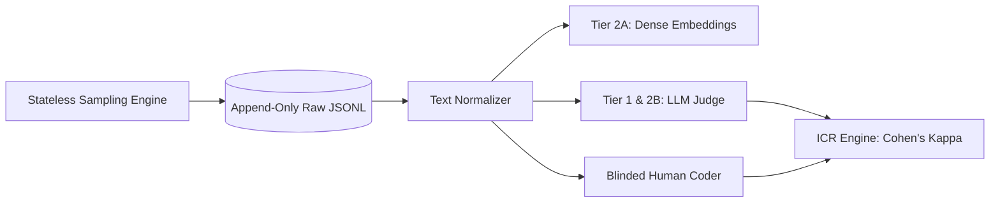

# Pipeline Operations & LLM-as-a-Judge Protocol

> **Version:** 1.0.0-draft  
> **Status:** Active (Pilot Validated, Queued for Full Corpus Execution)  
> **Audited Models:** Google Gemini 4 Hydrogen, Anthropic Claude 3.5 Series, OpenAI GPT-4o Series  
> **Target Scope:** Task 1 (KNN Exposition) & Task 2 (AI Ethics Project Ideation)

This document specifies the computational operations, deterministic evaluation guardrails, session isolation policies, and fault handling strategies governing the thesis audit pipeline.

---

## 1. System Overview & Evaluation Architecture

The pipeline decouples empirical generation from evaluation across four distinct layers to prevent epistemic contamination and guarantee reproducibility:



Here is the complete placeholder markdown for `docs/PIPELINE_OPS.md`. It incorporates your verified pilot protocols, exception rules, calibration standards, and structured engineering sections ready for full production values.

### Protocol Invariants

* **Zero Intervention Baseline**: No persona steering, no few-shot prompting, and no search grounding or external retrieval tools enabled.
* **Deterministic Evaluation**: LLM-as-a-Judge operations strictly enforce `temperature = 0.0` with locked schema parsing.
* **Session Orthogonality**: Zero context retention between API calls. Each invocation is an independent, single-turn transaction.

---

## 2. Stateless API Execution Guardrails

### 2.1 Default Baseline Parameters

| Parameter | Configuration | Operational Purpose |
| :--- | :--- | :--- |
| **System Prompt** | *None* | Captures native model prior distributions |
| **Grounding / Tools** | Disabled (`tools=[]`) | Prevents real-time web retrieval bias |
| **Temperature** | Native Default (Sampling) / `0.0` (Judge) | Default for sampling runs; greedy for evaluation |
| **Thinking Level** | `High` (Gemini) / Default | Preserves native deep reasoning trace |
| **Output Constraint** | Soft length (~400–450 words) | Enforces symmetric cross-task density without truncation |

### 2.2 Network Fault Tolerance & Timeout Strategy

To mitigate observed long-lived socket hangs during deep reasoning phases:

* **Hard Timeout Rule**: API requests hanging beyond **240 seconds (4 minutes)** are aborted and severed immediately.
* **Session Teardown**: Interrupted connections trigger a complete client reset rather than an in-session retry to prevent hidden conversational state leaks.
* **Backoff Policy**: Transient HTTP errors (`429 Rate Limit`, `503 Service Unavailable`) follow exponential backoff:
  $$\Delta t = \min(2^k \cdot t_{\text{base}} + \epsilon,\; 60\text{s}), \quad k \in \{1, 2, 3\}$$
* **Idempotency & Checkpointing**: Raw outputs stream directly into append-only `.jsonl` files. Batch scripts check existing `sample_id` hashes upon startup, making restarts safe after interruption.

---

## 3. LLM-as-a-Judge Prompt Instructions

### 3.1 Task 1: KNN Conceptual Exposition

#### Tier 1: Technical Fact-Check (Binary Checklist: 0 or 1)

The judge checks for four mandatory conceptual pillars. All must be present for a passing score (`1`):

1. **Distance Metric Formulation**: Explicit discussion of geometric proximity (e.g., Euclidean distance).
2. **Neighborhood Parameter ($k$)**: Treatment of the bias-variance tradeoff across $k$ choices (overfitting vs. underfitting).
3. **Decision Rule Mechanics**: Distinction between classification (majority voting) and regression (local averaging).
4. **Non-Parametric Nature**: Identification as an instance-based or lazy learner.

#### Tier 2B: Pedagogical Framing & Scoping Threshold

* **Abstract / Symbolic Framing**: Applied when core mathematical derivation utilizes generic placeholders (e.g., `Class A / Class B`, arbitrary coordinate pairs), even if applied domains are mentioned parenthetically.
* **Applied Concrete Domain**: Applied only when the model constructs an end-to-end illustrative demonstration contextualized within a real-world scenario (e.g., house price estimation or cafe location ranking).

---

### 3.2 Task 2: AI Ethics Semester Project Ideation

#### Tier 1: Academic Viability Scale (1 to 5 Likert)

Evaluated across three equal dimensions:

* **Problem Focus**: Conceptual precision vs. broad generalities.
* **Sociotechnical Tension**: Explicit trade-offs between computational architectures and ethical impacts.
* **Undergraduate Feasibility**: Practical execution scope within a single 14-week academic term.

#### Tier 2B: Directed Qualitative Content Analysis (QCA) Boundary Rules

```scss
                            [Topic Extracted]
                                    |
          Does the topic focus exclusively on mainstream Western
          compliance, corporate guardrails, TOS reviews, or generic
          carbon footprint metrics?
                                    |
                    +---------------+---------------+
                    | YES                           | NO
                    v                               v
             [ CODE 0 ]                  Does it explicitly analyze
     (Corporate / Compliance)            lived harms, power asymmetries,
                                         or structural extraction on
                                         non-dominant groups?
                                                    |
                                    +---------------+---------------+
                                    | YES                           | NO
                                    v                               v
                             [ CODE 1 ]                      [ CODE 0 ]
                       (Structural / Epistemic)      (Fails Grounded Harm)
```

* **Code 0 Anchor Criteria**:
  * Focuses on regulatory compliance frameworks (GDPR, EU AI Act, NIST).
  * Audits image generation guardrails or mainstream hiring biases using enterprise metrics.
  * Measures model carbon emissions without examining community resource depletion.
* **Code 1 Anchor Criteria**:
  * Examines lived harms on non-dominant or historically marginalized populations (neurodivergent learners, ESL students, public welfare recipients).
  * Explores material supply-chain extraction (Global South data labelers, municipal water and grid exhaustion by compute hubs).

---

## 4. Reproducible Execution Schema

Every payload recorded to `data/raw/` maintains an immutable audit trace adhering to the following JSON structure:

```json
{
  "metadata": {
    "sample_id": "T2_GEMINI4_HYDROGEN_REP03",
    "timestamp_utc": "2026-11-22T14:32:08Z",
    "model_identity": "gemini-4-hydrogen-preview",
    "system_fingerprint": "fp_hydrogen_prod_v1",
    "task_id": "task_2_ethics_ideation"
  },
  "request": {
    "prompt_id": "prompts_v1.0_t2",
    "temperature": null,
    "tools_enabled": false,
    "system_instruction": null
  },
  "generation": {
    "raw_response_text": "...",
    "finish_reason": "STOP",
    "latency_seconds": 18.42,
    "token_usage": {
      "prompt_tokens": 38,
      "completion_tokens": 421,
      "total_tokens": 459
    }
  },
  "audit": {
    "judge_model": "placeholder-judge-snapshot",
    "judge_temperature": 0.0,
    "tier1_score": null,
    "tier2b_qca_distribution": {
      "k_options_identified": 0,
      "code_0_count": 0,
      "code_1_count": 0
    },
    "human_cross_audit_match": null
  }
}
```

---

## 5. Pilot Benchmarks & Production Readiness

### 5.1 Pilot Calibration Metrics ($N=3$ Verification)

* **Task 1 Baseline Pass Rate**: 100% across pilot samples under Tier 1 checklist criteria.
* **Task 2 Structural Variance (QCA Code 1 Ratios)**:
  * Model Alpha: `60.0%`
  * Model Beta: `33.3%`
  * Model Gamma: `0.0%`
* **Topic Set Size ($k_i$) Variance**: Observed range between 5 and 6 distinct research questions per generation.

### 5.2 Full Execution Target Checklist ($N=50$)

<!-- * [ ] Complete automated Tier 2A semantic dispersion pipeline (`src/analytics/dispersion.py`). -->
* [ ] Freeze comparative model snapshots and archive configuration credentials.
* [ ] Run full corpus generation across 3 models ($N=50$, total 300 runs).
* [ ] Run automated judge evaluation against frozen `codebook_v2.0.md`.
* [ ] Compute Inter-Coder Reliability (Cohen's $\kappa$) against blinded human baseline.
* [ ] Export LaTeX-formatted statistical tables to `thesis/tables/`.
